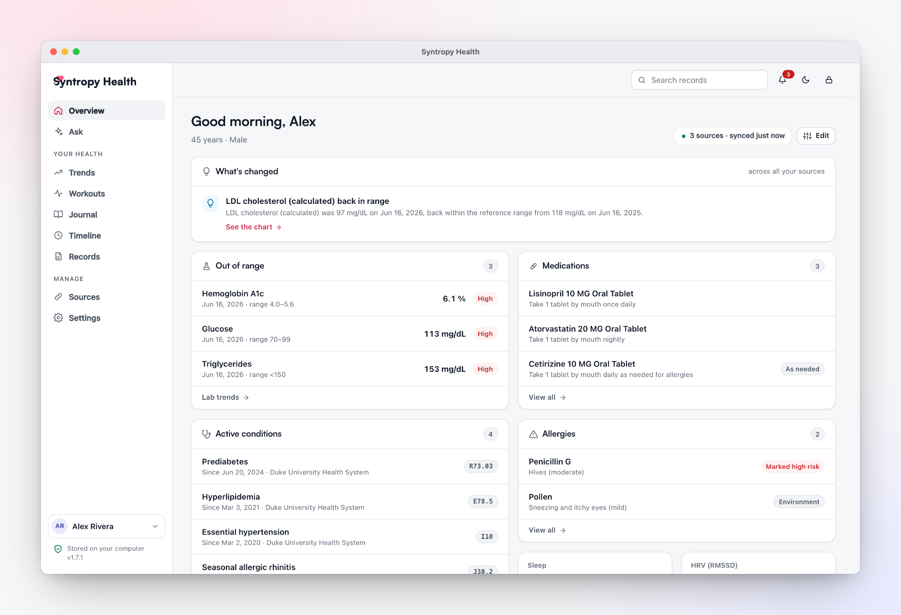
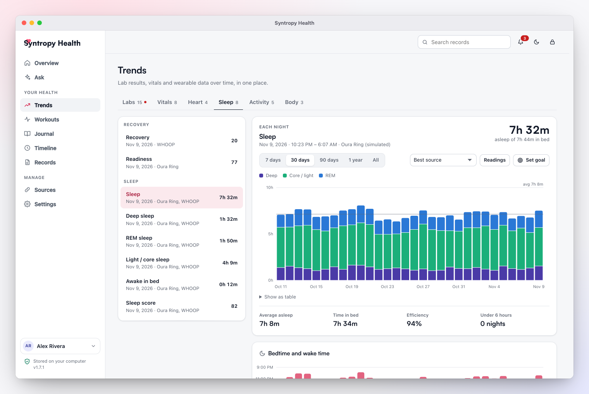
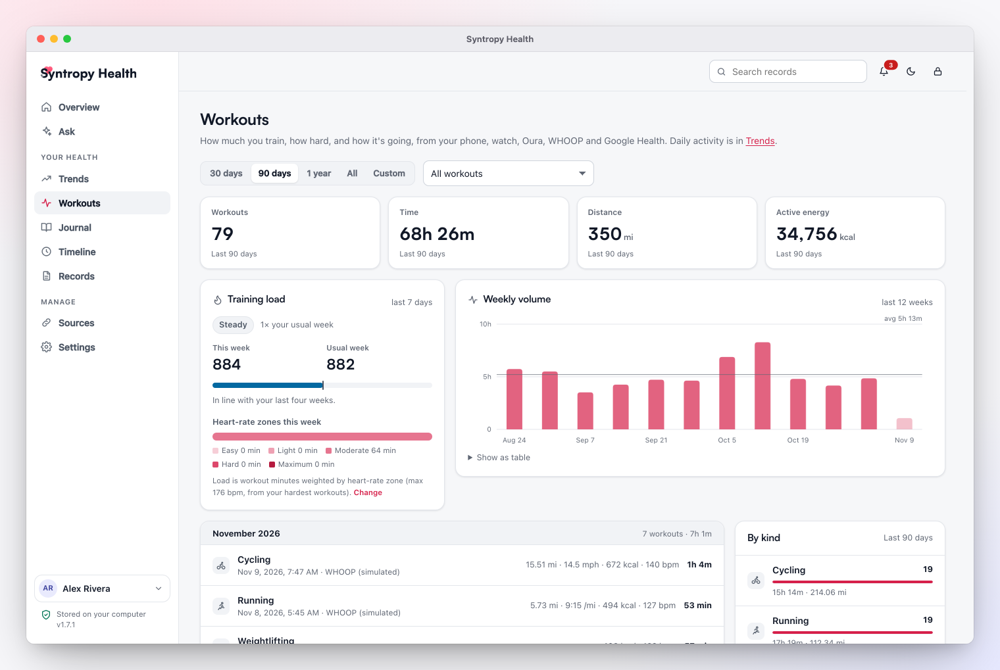
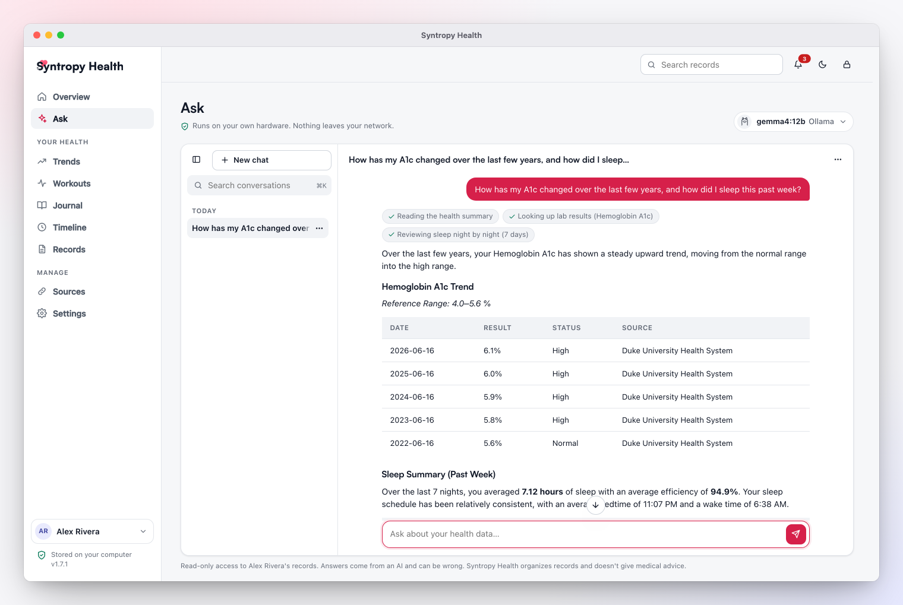
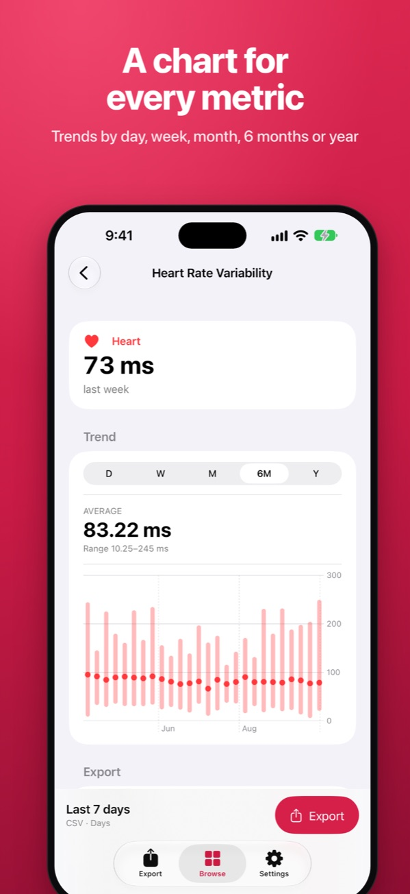
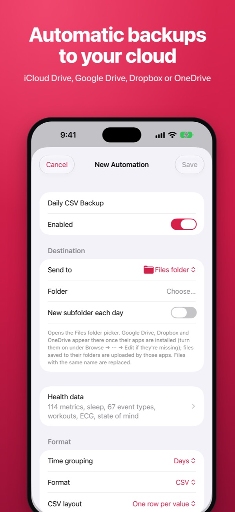
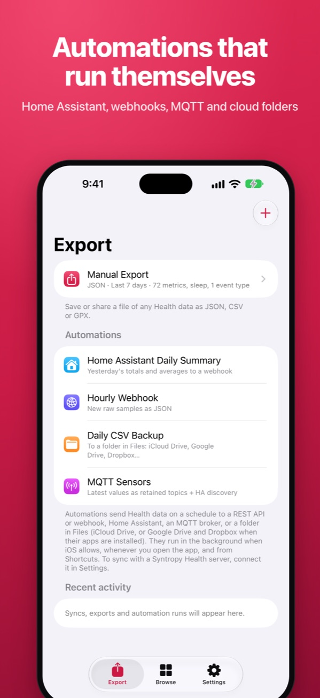
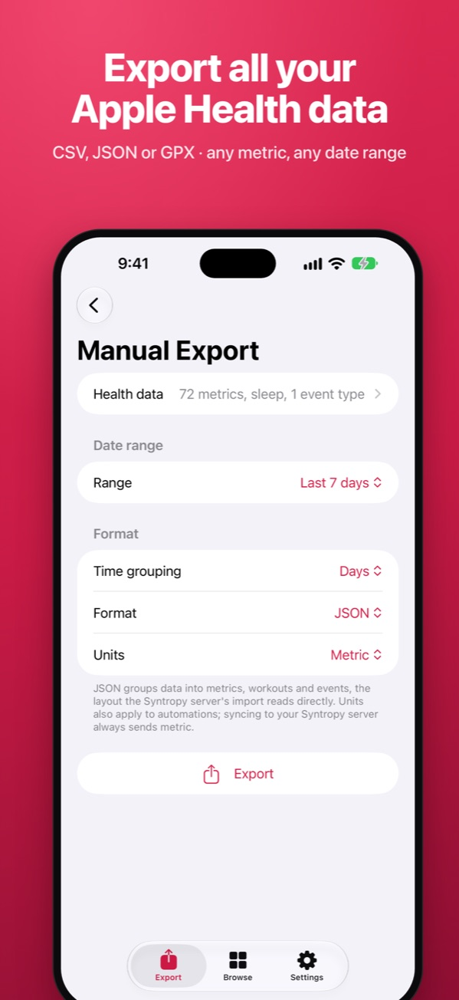

<div align="center">


# Syntropy Health

**Your medical records, wearables and Apple Health in one private place, on a computer you own.**

Free and open source. No Syntropy account, and no Syntropy cloud.

<a href="https://health.syntropylabs.io/download/mac"></a>
<a href="https://health.syntropylabs.io/download/windows"></a>
<a href="https://apps.apple.com/us/app/syntropy-health-export-sync/id6817550646"></a>

[Website](https://health.syntropylabs.io/) · [Linux and Docker](#get-started) · [Setup guides](https://health.syntropylabs.io/setup/) · [How it works](https://health.syntropylabs.io/docs/) · [Changelog](CHANGELOG.md)

[](https://github.com/EnriqueNeyra/syntropy-health/releases/latest)
[](https://github.com/EnriqueNeyra/syntropy-health/actions/workflows/ci.yml)
[](LICENSE)
[](https://hl7.org/fhir/R4/)
[](https://modelcontextprotocol.io)

</div>

<p align="center">
  <picture>
    <source media="(prefers-color-scheme: dark)" srcset=".github/images/hero-dark.png">
    
  </picture>
</p>

## Why Syntropy Health

Your health data is scattered. Lab results and diagnoses sit in a different patient portal for every hospital, sleep
and heart rate live in your ring or watch app, and Apple Health holds everything else. Syntropy Health brings it all
into one record on your own Mac, PC or home server, and shows it plainly: every value with its unit, date, source and
standard range.

- **One record for everything.** Labs, medications, conditions, visits and notes from your patient portals sit next to
  sleep, heart rate, HRV and workouts from Oura, WHOOP and Apple Health. Duplicates are merged, and when your watch and
  your ring both measure something, it's counted once.
- **Private by design.** It runs on hardware you control. Your records go straight from the hospital or device to your
  computer, and Syntropy Labs never receives them. The database is encrypted on disk and sits behind a password.
- **Ask with the AI you choose, or none.** Run a model on your own computer so nothing leaves your network, use your own
  API key, or connect the AI apps you already use. The AI can only read, and every lookup is logged.
- **For the people you care for.** Keep records for a partner, a child or a parent, and share access within your household.
- **Yours to take anywhere.** Print a one-page visit summary, export to FHIR R4 or CSV, or back everything up into one
  encrypted file.

Syntropy Health is in beta. It organizes your records; it doesn't diagnose anything or give medical advice.

## A quick tour

<table>
  <tr>
    <td width="50%" valign="top">
      <br>
      <b>Trends.</b> Every lab result over the years, against its reference range, with where each one came from.
    </td>
    <td width="50%" valign="top">
      <br>
      <b>Sleep.</b> Stages night by night from Oura, WHOOP or Apple Watch, with bedtimes, averages and efficiency.
    </td>
  </tr>
  <tr>
    <td width="50%" valign="top">
      <br>
      <b>Workouts.</b> Training load, weekly volume and heart-rate zones, for every kind of workout.
    </td>
    <td width="50%" valign="top">
      <br>
      <b>Ask.</b> Questions answered from your own records. Here, by a model running on the same computer.
    </td>
  </tr>
</table>

<sub>Screenshots use the app's built-in demo data: a simulated patient portal, Oura Ring and WHOOP.</sub>

## What it connects to

| Source | How it connects | Keeps syncing |
|---|---|---|
| **Epic (MyChart)** and **Oracle Health** hospitals and clinics | Sign in to your patient portal (SMART on FHIR), read-only | Yes |
| **athenahealth** practices | Patient-portal sign-in, read-only | Yes |
| **eClinicalWorks** practices (healow) | Patient-portal sign-in, read-only | No: a one-time import. Sign in again to update |
| **Record files** from any portal: FHIR, C-CDA or CCD (`.xml`), XDM zips, Apple Health Records exports | Import the file under **Sources** | One import per file |
| **Lab reports**, as a PDF or a photo of the paper | Read on your own computer (OCR), built into the Mac and Windows apps and the Docker image | One import per report |
| **Apple Health**: iPhone, Apple Watch and the apps that write to it, like Garmin, Withings, Strava and Dexcom | The [iPhone app](https://apps.apple.com/us/app/syntropy-health-export-sync/id6817550646), or an export file | Yes, in the background with the iPhone app |
| **Oura** and **WHOOP** | Sign in once | Yes |
| **Fitbit** and **Pixel Watch** (Google Health) | Your own Google Cloud app, in **Settings → Wearables**. For technical users | Yes, with a new sign-in about weekly while the Google project is in testing |

The directory lists about 39,500 health systems and practices. The ones you can connect to today are about 2,700 Epic
and Oracle Health organizations, athenahealth practices, and 18,000 eClinicalWorks practices as one-time imports.
Portal access is read-only, and you can revoke it at the portal at any time.

**Coming next:** TruBridge, MEDHOST, Greenway, ModMed, NextGen and Practice Fusion are listed while their registrations
are under way (until then, import a record file from the portal), and an Android app for Health Connect. The VA and
Indian Health Service aren't supported.

Oura and WHOOP sign-ins pass through a small open-source relay ([cloudflare-worker](cloudflare-worker)) that holds the
app secret. It doesn't store tokens or read your data, and you can skip it with your own Oura or WHOOP app.

## The iPhone app

<p align="center">
  
  
  
  
</p>

[**Syntropy: Health Export & Sync**](https://apps.apple.com/us/app/syntropy-health-export-sync/id6817550646) is free on
the App Store for iOS 17 or later. Paired with your Syntropy Health, it sends new Apple Health data home in the
background, straight over your own network. If your computer is off, the phone holds on to the data until it's back.

It's useful on its own too: chart every metric, and back up or export Apple Health as CSV, JSON or GPX to iCloud Drive,
Google Drive, Dropbox or OneDrive, or to Home Assistant, webhooks and MQTT.

To pair it, choose **Sources → Phones & watches → Pair iPhone** in Syntropy Health, or **Settings → Connect to my
server** in the app. The phone apps aren't open source; the server and the Mac and Windows apps are.

## Get started

| Your computer | Install |
|---|---|
| **Mac** (Apple silicon, macOS 12 or later) | [Download the app](https://health.syntropylabs.io/download/mac), or `curl -fsSL https://health.syntropylabs.io/install.sh \| sh` |
| **Windows** (10 and 11, 64-bit) | [Download the app](https://health.syntropylabs.io/download/windows), or `irm https://health.syntropylabs.io/install.ps1 \| iex` in PowerShell |
| **Linux home server** | `curl -fsSL https://health.syntropylabs.io/install.sh \| sudo sh` |
| **Docker or a NAS** | In a clone of this repository, `mkdir data && docker compose up -d`; or `docker run -d --name syntropy-health --restart unless-stopped -p 8000:8000 -v syntropy-data:/data ghcr.io/enriqueneyra/syntropy-health` |
| **From source** | `git clone https://github.com/EnriqueNeyra/syntropy-health && cd syntropy-health && ./run.sh` |

It works best on a computer that stays on, like a Mac mini or a home server, so syncs keep running around the clock.
A laptop works too: nothing is lost while it sleeps.

The Mac and Windows apps walk you through setup. Otherwise, open <http://localhost:8000> and follow the steps. On a
server that has no password yet, the first password needs a one-time setup code from the server's log, unless you set
it from the same computer, your home network or Tailscale.

No accounts handy? Turn on developer mode in **Settings → Developer** to connect the built-in **EHR simulator** and
simulated Oura or WHOOP data, and explore everything with made-up records.

> [!NOTE]
> The Mac app is signed and notarized by Apple. The Windows installer isn't code-signed yet, so Windows may show
> "Windows protected your PC": choose **More info**, then **Run anyway**.

Syntropy Health tells you when a new version is out, and the Mac and Windows apps can install it themselves. Syntropy
Labs' registrations with health systems, Oura and WHOOP, and its sign-in relay, come with the releases above, which
carry a key the relay checks. A copy built from the source code, or a fork, uses its own: a client ID in **Settings →
Developer**, or an Oura or WHOOP app in **Settings → Wearables**.

Install options, configuration and remote access are covered step by step at
[health.syntropylabs.io/setup](https://health.syntropylabs.io/setup/).

## Ask, with the AI you choose

Ask answers questions from your own records with read-only lookups that it shows you as it goes and keeps in a log.
In **Settings → AI**, choose who answers:

- **A model on your own hardware**, like Ollama, LM Studio or vLLM, on this computer or another at home. Nothing leaves your network.
- **An AI agent you already use**: Claude Code, Codex or Gemini CLI, signed in on the same computer.
- **Your own API key** from Anthropic, OpenAI, Google, OpenRouter or any OpenAI-compatible service.
- **Any app that supports MCP**, like Claude Desktop, Cursor or VS Code, through the built-in
  [Model Context Protocol](https://modelcontextprotocol.io) server.

An AI outside your network sees what you ask and what it looks up, so Syntropy Health asks each person before an online
AI reads their records. Everything else works with no AI at all.

## Privacy and security

- **No Syntropy cloud.** Your data lives in one SQLite database on your own hardware. Syntropy Labs never receives it,
  and this project's website has no analytics or trackers.
- **Encrypted on disk** with SQLCipher. On a Mac or Windows PC the key is kept in the Keychain or Windows' protected
  storage; on Linux and Docker it stays beside the data unless you put it elsewhere. That protects a copy of the files,
  not a running computer, so keep FileVault or BitLocker on as well. Read
  [what this protects and what it can't](.github/SECURITY-MODEL.md).
- **Locked by default.** A password is required, and AI lookups are logged.
- **Read-only access** to your patient portals, which you can revoke at the portal at any time.
- **Open to inspection.** The server and the Mac and Windows apps are public under the AGPL, for you or anyone you
  trust to check.

## Running your server

<details>
<summary><b>Backups, restoring and moving to a new computer</b></summary>

<br>

Everything lives in one data folder, and the database is encrypted. On a Mac or Windows PC the key isn't in that folder,
so a copy of the folder won't open on another computer: **use a backup to move your data**. An encrypted backup holds
everything, including the key, so its passphrase is all a new computer needs. Keep backups somewhere only you can reach.

```
syntropy-health backup /path/to/folder            # one encrypted file, protected by a passphrase you choose
syntropy-health restore FILE --check              # test a backup and say what's in it; changes nothing
syntropy-health restore FILE                      # stop the server first; what it replaces is kept beside the data
syntropy-health restore FILE --key-only           # take only the encryption key from a backup, for a lost key
syntropy-health key status                        # what's encrypted, and where the key is
syntropy-health key recover                       # bring back a lost key with the password of an owner of this server
syntropy-health key export FILE                   # a copy of the key to keep somewhere apart from the data
syntropy-health database decrypt FILE             # an unencrypted copy, to go back to an earlier version or use other tools
```

Settings also has Backup and Restore, and scheduled backups to a folder. `--no-encrypt` makes a plain zip that anyone
who gets the file can read. On Docker, run the same commands through the container:

```
docker exec -it syntropy-health syntropy-health backup /data/backups
docker exec -it syntropy-health syntropy-health accounts reset-password NAME
```

`-it` is what lets you type the backup's passphrase. For a scheduled job, where no one is there to type, use
`--passphrase-file` with a file the container can read.

Before upgrading its database, Syntropy Health keeps a copy in a pre-upgrade folder beside it, and won't upgrade if it
can't.

**Without the key, your records can't be read by anyone, and nobody can recover them for you.** If it's lost (resetting a
forgotten Mac password can do it, for example), it comes back from any of these: the password of an owner of this server,
which the start page asks for on a Mac or Windows PC; `restore FILE --key-only` with any backup made by this version; or a
copy you made with `key export`, put back as `secret.key` in the data folder. So keep a backup somewhere else. `key new`
only helps a database that isn't encrypted, or one that opens but whose saved sign-ins don't.

To keep the key apart from the data on Linux or Docker, set `SYNTROPY_KEY_FILE` to a file elsewhere, such as a Docker secret.
AI apps that start the MCP server themselves need that setting too. `SYNTROPY_SECRET_KEY` holds the key itself, so it isn't
copied into their settings: with that one, AI apps connect to the server's `/mcp` address instead.

</details>

<details>
<summary><b>Accounts and remote access</b></summary>

<br>

`syntropy-health accounts` lists who signs in. `accounts reset-password NAME` sets a new password for someone locked
out, and `accounts make-owner NAME` hands the server to someone else or adds another owner. On a server that has no
password yet, the first password needs the one-time setup code printed in the server's log, unless it's set from the same
computer, the home network or Tailscale.

Away from home, the simplest private option is [Tailscale](https://tailscale.com/) on your server and your phone. Avoid
opening your server to the internet directly. Behind a reverse proxy (Caddy, nginx, a Cloudflare Tunnel), pass on
`X-Forwarded-Proto` and `X-Forwarded-Host`, and set `FORWARDED_ALLOW_IPS` to the proxy's address. On your home network
the connection to the server is plain HTTP unless you use Tailscale or a reverse proxy, so only let devices connect on
networks you trust.

</details>

<details>
<summary><b>Checking a download</b></summary>

<br>

Every release file has a signed provenance attestation. With the [GitHub CLI](https://cli.github.com):
`gh attestation verify FILE -R EnriqueNeyra/syntropy-health`. The install scripts and `syntropy-health update` also
check files against the release's published checksums.

</details>

<details>
<summary><b>Uninstalling</b></summary>

<br>

Removing Syntropy Health keeps your data (every person's profile, sign-in and records) unless you choose to delete
it, so installing again picks up where you left off. Back it up first if you might want it later.

| Install | Remove it | Your data |
|---|---|---|
| Mac app | **Syntropy Health → Uninstall Syntropy Health…** in the menu bar: it quits, stops opening at login and moves to the Trash | It asks whether to delete it too. Dragging the app to the Trash yourself keeps it in `~/Library/Application Support/Syntropy Health` |
| Windows app | **Settings → Apps → Installed apps → Syntropy Health → Uninstall** | The uninstaller asks whether to delete it too (`%LOCALAPPDATA%\Syntropy Health`) |
| Mac or Windows background server | `curl -fsSL https://health.syntropylabs.io/install.sh \| sh -s -- --uninstall` or `& ([scriptblock]::Create((irm https://health.syntropylabs.io/install.ps1))) -Uninstall` | Kept; add `--purge` or `-Purge` to delete it |
| Linux home server | `curl -fsSL https://health.syntropylabs.io/install.sh \| sudo sh -s -- --uninstall` | Kept in `/var/lib/syntropy-health`; add `--purge` to delete it |
| Docker | `docker compose down` (or `docker rm -f syntropy-health`) | Kept in `./data` (or the `syntropy-data` volume): delete the folder, or `docker volume rm syntropy-data` |
| `uv tool` | `syntropy-health service uninstall`, then `uv tool uninstall syntropy-health` | Kept; `syntropy-health info` shows where |

Your phone keeps what it already synced; pair it again after reinstalling. Health-system sign-ins end with the data:
delete it and you connect each one again.

</details>

## Documentation

- [Set up](https://health.syntropylabs.io/setup/): install on a Mac, Windows PC, Linux home server or Docker, and pair your iPhone
- [How it works](https://health.syntropylabs.io/docs/): architecture, the data handled and the security model

## Contributing

Bug reports, ideas and pull requests are welcome. Read [CONTRIBUTING.md](.github/CONTRIBUTING.md) to get set up (the
test suite runs fully offline against the simulator), and please never include real health information in an issue.
Security problems go to [SECURITY.md](.github/SECURITY.md), not a public issue. Everyone taking part follows the
[code of conduct](.github/CODE_OF_CONDUCT.md).

## Disclaimer

Syntropy Health organizes information you're entitled to under the 21st Century Cures Act. It is not a medical device
and doesn't give medical advice: check anything important with your care team.

## License

Free and open source under the [GNU Affero General Public License v3.0 only](LICENSE). You can use, study, change and
share it; if you share a changed version, or run one that other people use over a network, offer them its source under
the same license. The Syntropy Health name, logo and icons aren't covered, and the program carries a short not-medical-advice
notice as additional terms under section 7: see [NOTICE](NOTICE). The [Terms](https://health.syntropylabs.io/terms/) cover
Syntropy's website and sign-in relay, and aren't a condition of the license.
