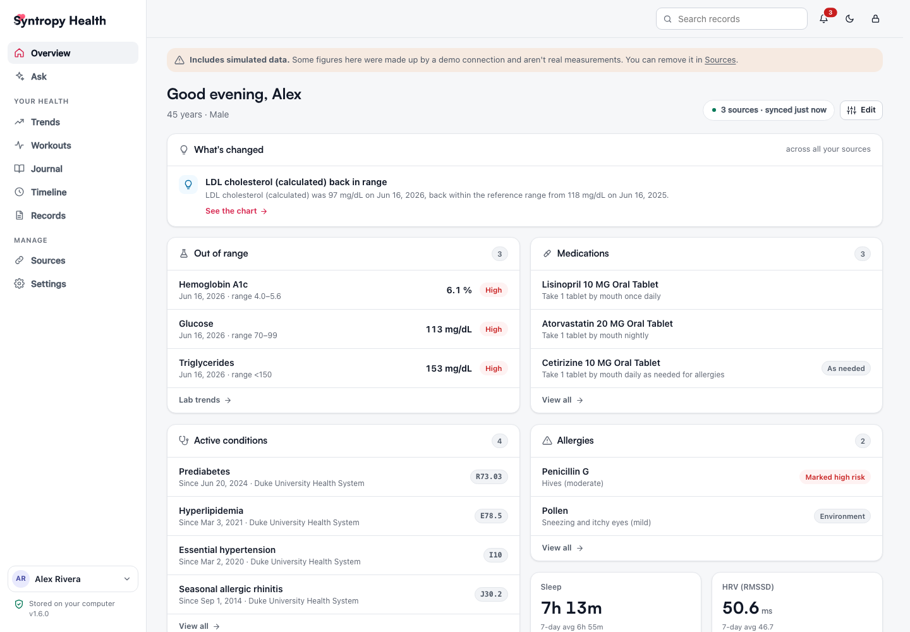
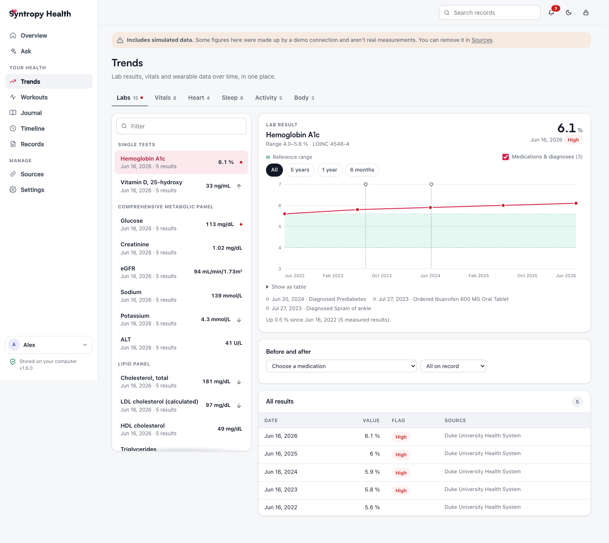

<div align="center">


# Syntropy Health

**The open-source, self-hosted personal health record.**
Medical records from your patient portals, Apple Health and wearable data, and insights across all of it, on a computer you control.

[](https://github.com/EnriqueNeyra/syntropy-health/actions/workflows/ci.yml)
[](LICENSE)
[](pyproject.toml)
[](https://hl7.org/fhir/R4/)
[](https://modelcontextprotocol.io)

**[health.syntropylabs.io](https://health.syntropylabs.io/)** · [Download](https://health.syntropylabs.io/setup/) · [Get started](#get-started) · [Docs](#documentation) · [Changelog](CHANGELOG.md)

</div>

<p align="center"></p>

## Works today / Coming

| Source | How it connects | Stays synced? | Status |
|---|---|---|---|
| Epic (MyChart) and Oracle Health hospitals and clinics | Sign in to the patient portal (SMART on FHIR), read-only access you can revoke | Yes, on a schedule | Works today |
| athenahealth practices | Patient portal sign-in, read-only | Yes, on a schedule | Works today |
| eClinicalWorks practices (healow) | Patient portal sign-in, read-only | No: a one-time import. Sign in again to update | Works today |
| TruBridge, MEDHOST, Greenway, ModMed, NextGen, Practice Fusion | Listed; registration is under way | Not yet | Coming. Meanwhile, import a record file from the portal |
| Record files from any portal | Import a FHIR file, an Apple Health Records export, a C-CDA or CCD (.xml) or an XDM zip | No: one import per file | Works today |
| Lab report photos or PDFs | Text reading (OCR) on your computer | No | Works today (needs Tesseract) |
| Oura and WHOOP | Sign in once | Yes | Works today. The sign-in passes through a small open-source relay |
| Fitbit and Pixel Watch (Google Health) | Your own Google Cloud app and client ID in **Settings → Wearables** | Yes, but a Google project in Testing needs a new sign-in about weekly | Works today, for technical users |
| Apple Health | Import the Health export file | No: manual | Works today. The iPhone app that syncs it in the background isn't out yet |
| Health Connect (Android) | The Android app | Yes | Coming. The app isn't out yet |
| Garmin, Withings, Strava, Dexcom and others | Through Apple Health or Health Connect | Same as above | Manual export only for now |

It's in beta. The iPhone and Android apps aren't open source and aren't out yet; the server and the Mac and Windows apps
are. The VA and Indian Health Service aren't supported.

**Why choose it:** it runs entirely on a computer you control, it merges patient portals with wearables in one record,
you choose the AI (or none), and everything it does with your records is read-only and logged.

## What it does

Your health data is scattered: lab results and diagnoses in one patient portal per hospital, sleep and heart rate in a
ring or watch app, workouts somewhere else, how you felt nowhere at all. Syntropy Health brings it together in one
record on your own Mac, PC or home server, and shows the facts side by side: values, units, dates, sources, the
standard range for a result and whether it's outside it, and changes from your own usual numbers.

- **Records from the portals you use.** Connects to patient portals through the standard SMART on FHIR patient-access
  APIs and merges labs, medications, conditions, visits and notes into one de-duplicated record. The directory lists
  about 39,500 health systems; the ones you can connect to today are mainly Epic and Oracle Health organizations
  (about 2,700), athenahealth practices, and 17,000+ eClinicalWorks practices as one-time imports. Access is read-only,
  and you can revoke it at the portal at any time.
- **Wearables and phone.** Oura, WHOOP and Google Health, plus Apple Health and Health Connect, without
  double-counting devices.
- **Trends, a visit summary and a journal.** Trends, sleep, training and a daily journal in one place, a printable
  visit summary, and notes on what changed, always with the numbers behind them.
- **Ask with the AI you choose.** A local model (Ollama, LM Studio) so nothing leaves your network, your own API key,
  or the AI apps you already use through the built-in [Model Context Protocol](https://modelcontextprotocol.io) server.
  Access is read-only and every lookup is logged.
- **No Syntropy cloud.** Your data lives in one SQLite database on your own hardware, behind a password, and Syntropy
  Labs never receives it. Saved sign-ins are encrypted. **The records themselves are not encrypted by Syntropy Health:
  turn on FileVault (Mac) or BitLocker (Windows)**, and treat the data folder and your backups as the record. Export
  to FHIR R4 or CSV any time.
- **Oura and WHOOP sign-ins pass through a small open-source relay** ([cloudflare-worker](cloudflare-worker)) that
  holds the app secret. It doesn't store tokens or read your data. Use your own Oura or WHOOP app to skip it.
- **For the people you care for.** Keep records for a partner, a child or a parent, and share access within your
  household. An account is limited to one person unless the owner gives it access to others.

It organizes records and doesn't give medical advice or diagnose anything.

<p align="center"></p>

## Get started

| Your computer | Install |
|---|---|
| **Mac** (Apple silicon, macOS 12+) | [Download the app](https://health.syntropylabs.io/download/mac), or `curl -fsSL https://health.syntropylabs.io/install.sh \| sh` |
| **Windows** (10 and 11, 64-bit) | [Download the app](https://health.syntropylabs.io/download/windows), or `irm https://health.syntropylabs.io/install.ps1 \| iex` (PowerShell) |
| **Linux home server** | `curl -fsSL https://health.syntropylabs.io/install.sh \| sudo sh` |
| **Docker / NAS** | In a clone of this repository, `mkdir data && docker compose up -d`; or `docker run -d --name syntropy-health --restart unless-stopped -p 8000:8000 -v syntropy-data:/data ghcr.io/enriqueneyra/syntropy-health` |
| **From source** | `git clone https://github.com/EnriqueNeyra/syntropy-health && cd syntropy-health && ./run.sh` |

The Mac and Windows apps walk you through setup; otherwise open <http://localhost:8000> and follow it. On a server
that has no password yet, the first password needs a one-time setup code printed in the server's log (on the same
computer, the home network or Tailscale, it isn't needed). No accounts handy? Turn on developer mode in **Settings →
Developer** to connect to the built-in **EHR simulator**, and add simulated Oura or WHOOP data to explore everything with synthetic records.

Syntropy Labs' registrations with health systems, Oura and WHOOP, and its sign-in relay, come with the releases above
(they carry a key the relay checks).
A copy built from the source code (or a fork) uses its own: a client ID in **Settings → Developer**, or an Oura or
WHOOP app in **Settings → Wearables**.

Syntropy Health tells you when a new version is out, and the Mac and Windows apps can install updates themselves.
Install options, configuration and remote access are in the step-by-step guides at
[health.syntropylabs.io/setup](https://health.syntropylabs.io/setup/).

## Importing a record file

If your health system isn't connectable yet, download your health summary from its patient portal and import it under
**Sources**. Supported: C-CDA and CCD files (`.xml`), XDM zips, FHIR files and Apple Health Records exports. Anything
that can't be read in detail stays readable under Clinical notes, and the original file is kept to download.

## Backups, restoring and upgrades

Everything lives in one data folder: the database, the encryption key (`secret.key`) and uploads. Back it up, and
keep backups somewhere only you can reach.

```
syntropy-health backup /path/to/folder            # one encrypted file, protected by a passphrase you choose
syntropy-health restore FILE --check              # test a backup and say what's in it; changes nothing
syntropy-health restore FILE                      # stop the server first; what it replaces is kept beside the data
syntropy-health restore FILE --key-only           # take only the encryption key from a backup, for a lost key
```

Settings also has Backup and Restore, and scheduled backups to a folder. `--no-encrypt` makes a plain zip that anyone
who gets the file can read. On Docker, run the same commands through the container:

```
docker exec -it syntropy-health syntropy-health backup /data/backups
docker exec -it syntropy-health syntropy-health accounts reset-password NAME
```

`-it` is what lets you type the backup's passphrase. For a scheduled job, where no one is there to type, use
`--passphrase-file` with a file the container can read.

Before upgrading its database, Syntropy Health keeps a copy in a pre-upgrade folder beside it, and won't upgrade if it
can't. A lost encryption key can't be recovered: saved sign-ins stop opening and each source asks you to connect
again. `syntropy-health key new` makes a fresh key once you've decided the old one is gone.

## Accounts and remote access

`syntropy-health accounts` lists who signs in. `accounts reset-password NAME` sets a new password for someone locked
out, and `accounts make-owner NAME` hands the server to someone else or adds another owner. On a server that has no
password yet, the first password needs the one-time setup code printed in the server's log, unless it's set from the same
computer, the home network or Tailscale.

Behind a reverse proxy (Caddy, nginx, a Cloudflare Tunnel), pass on `X-Forwarded-Proto` and `X-Forwarded-Host`, and set
`FORWARDED_ALLOW_IPS` to the proxy's address. On your home network the connection to the server is plain HTTP unless you
use Tailscale or a reverse proxy, so only let devices connect on networks you trust.

## Checking a download

Every release file has a signed provenance attestation. With the [GitHub CLI](https://cli.github.com):
`gh attestation verify FILE -R EnriqueNeyra/syntropy-health`. The install scripts and `syntropy-health update` also
check files against the release's published checksums.

## Documentation

- [Set up](https://health.syntropylabs.io/setup/): install on a Mac, Windows PC, Linux home server or Docker
- [How it works](https://health.syntropylabs.io/docs/): architecture, the data handled and the security model

## Uninstalling

Removing Syntropy Health keeps your data (every person's profile, sign-in and records) unless you choose to delete
it, so installing again picks up where you left off. Back it up first if you might want it later.

| Install | Remove it | Your data |
|---|---|---|
| Mac app | **Syntropy Health → Uninstall Syntropy Health…** in the menu bar: it quits, stops opening at login and moves to the Trash | It asks whether to delete it too. Dragging the app to the Trash yourself keeps it in `~/Library/Application Support/Syntropy Health` |
| Windows app | **Settings → Apps → Installed apps → Syntropy Health → Uninstall** | The uninstaller asks whether to delete it too (`%LOCALAPPDATA%\Syntropy Health`) |
| Mac or Windows background server | `curl -fsSL https://health.syntropylabs.io/install.sh \| sh -s -- --uninstall` or `& ([scriptblock]::Create((irm https://health.syntropylabs.io/install.ps1))) -Uninstall` | Kept; add `--purge` or `-Purge` to delete it |
| Linux home server | `curl -fsSL https://health.syntropylabs.io/install.sh \| sudo sh -s -- --uninstall` | Kept in `/var/lib/syntropy-health`; add `--purge` to delete it |
| Docker | `docker compose down` (or `docker rm -f syntropy-health`) | Kept in `./data` (or the `syntropy-data` volume): delete the folder, or `docker volume rm syntropy-data` |
| `uv tool` | `syntropy-health service uninstall`, then `uv tool uninstall syntropy-health` | Kept; `syntropy-health info` shows where |

Your phone keeps what it already synced; pair it again after reinstalling. Health-system sign-ins end with the data:
delete it and you connect each one again.

## Contributing

Bug reports, ideas and pull requests are welcome. Read [CONTRIBUTING.md](.github/CONTRIBUTING.md) to get set up (the test suite
runs fully offline against the simulator), and please never include real health information in an issue. Security
problems go to [SECURITY.md](.github/SECURITY.md), not a public issue. Everyone taking part follows the
[code of conduct](.github/CODE_OF_CONDUCT.md).

## Disclaimer

Syntropy Health organizes information you're entitled to under the 21st Century Cures Act. It is not a medical device
and doesn't give medical advice or diagnose anything. It shows what your records and devices report.

## License

Free and open source under the [GNU Affero General Public License v3.0 only](LICENSE). You can use, study, change and
share it; if you share a changed version, or run one that other people use over a network, offer them its source under
the same license. The Syntropy Health name, logo and icons aren't covered: see [NOTICE](NOTICE).
